# The effects

Every knob shows its real value on the pedal's screen where that makes sense (BPM, milliseconds, note names).

**Tempo comes from the pedal.** The tempo effects (DualShft, Choral, EuGate, DubSiren, Scrub, Breather, GRDELAY, Sweep) are made for the custom firmware [MIDISTOMP](https://github.com/matujuice/zoom-ms-midistomp) (v1.0 or later) and have no Tempo knob. They play at the pedal's tempo: MIDI clock, tap or the patch tempo. While a MIDI clock runs they stay on its grid: MIDI Start restarts their LFO, pattern or beat on the downbeat, and an effect switched on or loaded mid-song lands in the right place. After Stop they keep running at the last tempo. While one of them is switched off its LFO or pattern keeps following the clock, so it comes back in time. On stock firmware they follow the tap tempo and the patch TEMPO, without the MIDI clock. Release v1.5 has the older builds with a Tempo knob and the iPhone (Mozaic) bar sync.

### WaveFold: wavefolder

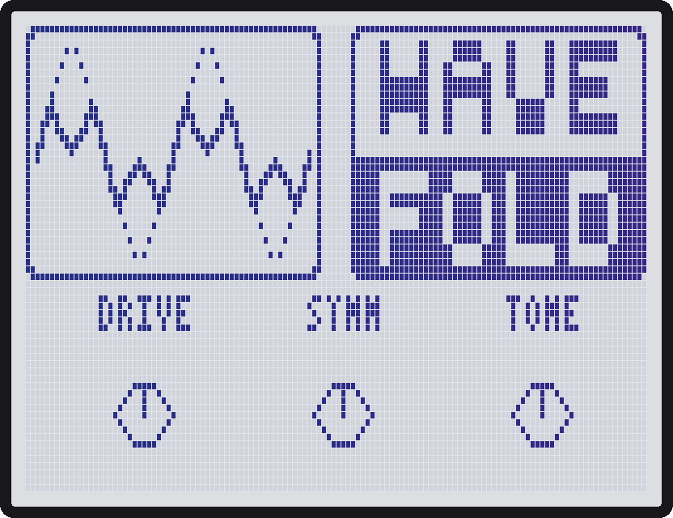
A fold curve from a published Buchla 259 model (Esqueda, Pontynen, Valimaki and Parker, DAFx-2017). Five parallel folding stages bend the sound back on itself as Drive goes up. The loudness is matched to your input automatically. No oversampling, so high notes at high Drive alias.

| Knob | Range | What it does |
|---|---|---|
| Drive | 0..100 | How hard the signal is pushed into the folder. Higher = more folds. |
| Symm | -50..+50 | 0 is symmetric. Away from 0 adds even harmonics. |
| Tone | 0..100 | Low-pass after the fold, about 200 Hz up to open. |
| Level | 0..100 | 50 = wet matches the input loudness, 100 = +6 dB. |
| Mix | 0..100 | Dry/wet crossfade, DJ style: the dry sound stays full up to 50, the effect is full from 50, so at 50 both play at full level. |

### DualShft: tempo-synced dual pitch shifter

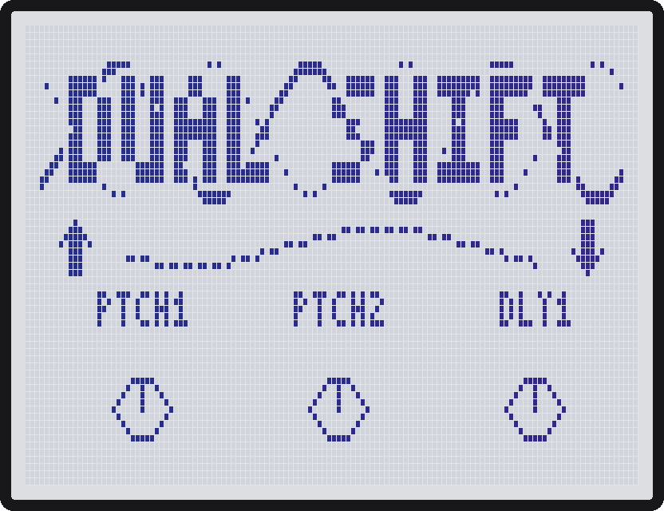
Two pitch-shift voices, each with its own echo time, plus one tempo-synced LFO that bends them in opposite directions. No feedback.

| Knob | Range | What it does |
|---|---|---|
| Ptch1 / Ptch2 | -24..+24 semitones | Pitch of each voice, with tenths of a semitone around 0. |
| Dly1 / Dly2 | 12 ms..1 s, note values | Echo time of each voice. The top of the knob syncs to the pedal's tempo as note values (1/32 .. 1 bar). A synced time too long for the 3.9 s buffer is halved (1 bar below about 62 BPM). |
| Div | 4 bars .. 1/64 | Length of one LFO cycle (dotted and triplet values included). |
| Depth | 0..12 semitones | How far the LFO bends the pitch. 0 = no LFO. |
| Shape | Tri, Sqr, Rand, Step, Sine, Rise, Fall | LFO shape. |
| Mix | 0..100 | Dry/wet crossfade, DJ style: the dry sound stays full up to 50, the effect is full from 50, so at 50 both play at full level. |

### Choral: choir

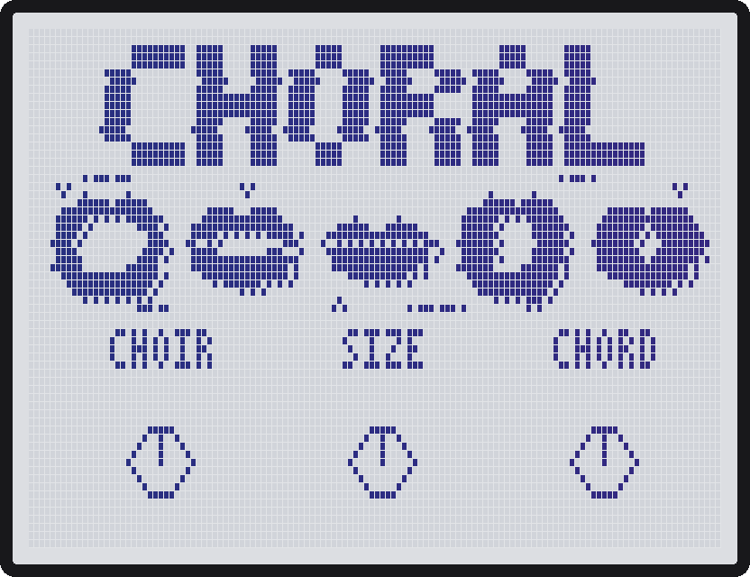
Listens to the note your synth plays and sings it with its own choir, so every synth (bright saw, sine, closed filter) gets the same voice. For mono lines: leads, basses, arps. A chord or a pad has no single note, so the choir drops out and only the dry synth plays. A new note is found in about 10 to 70 ms, octave jumps included, and fast arps (16ths at 160 BPM) are followed note by note: at Glide 0 a legato change hushes the old note and starts the new one fresh. Two detuned oscillators work too: when they drift in and out of phase and look like an octave or a fifth up, the choir waits 3 s before it believes it (a real octave jump is still taken at once). In a decay tail the choir keeps its note. Breath noise follows the singers' own level, so it stays well under the voice on high notes and high sections too.

| Knob | Range | What it does |
|---|---|---|
| Choir | MEN, WOMEN, KIDS, GIANT, M+W, M+KID, W+KID, G+M, G+W, G+KID, M+W+K, G+M+W, G+M+K, G+W+K, ALL, MONKS, GOSPL | Who sings: every combination of the four sections, then two characters: MONKS (men and giants, straight tone with no vibrato, dark) and GOSPL (men and women, wide vibrato, bright, breathy). MEN on your note, WOMEN an octave up, KIDS two up, GIANT one down; each section has its own throat, breath and vibrato. |
| Size | SOLO, DUO, TRIO, QUART, QUINT, SEXT | How many singers (1..6). A bigger choir is looser in timing and tuning. |
| Chord | UNIS, +1 .. +11, OCT, MAJ, MIN, SUS2, SUS4, DIM, AUG, MAJ7, MIN7, DOM7, ADD9, OPEN, DRONE | How they sing together. UNIS: all on your note. +1 to +11 and OCT: every second singer that many semitones (piano keys) up, from rubbing (+1, +2) to sweet (+3, +4), open (+5, +7) and the octave (OCT = +12). Chords: the singers take the chord's tones in order, so DUO sings root and 3rd, TRIO the triad, more singers add the octave and more. OPEN is root, 5th and 10th. DRONE: every second singer holds the first note of the phrase while the others follow you. The same shape on every note (no key). |
| Sing | AAH, EHH, EEE, OHH, OOH, MMM, OOAH, VOWL, LA, DOO, SWELL, CANON | What they sing. The first six are one vowel (MMM is a hum). OOAH opens from "oo" to "ah" and back once per Pace cycle; VOWL steps A E I O U, one per Pace cycle. LA and DOO sing a syllable once on every note: LA opens from "l" to "ah", DOO starts with a short stop and closes from "eh" to "oo"; Pace sets how long that takes (1/64 is a quick "la", 1bar a slow opening). SWELL: the choir breathes in and out once per Pace cycle. CANON: each section comes in one Pace cycle after the one before and sings what you played that much earlier (a round; one cycle can be at most 1 s). |
| Pace | 4bar .. 1/64 | Length of one cycle of the movement. |
| Feel | 0..100 | 0 = soft and legato (slow attack, wide vibrato, breathy, dark) .. 100 = punchy and staccato (fast attack and release, bright, OOAH snaps). |
| Glide | 0..100 | 0 = every note starts fresh, even when you play legato (best for fast arps). 1..100 = legato: the voice keeps singing and slides to the new note, ~3 ms .. ~0.6 s. |
| Mix | 0..100 | Dry synth / choir crossfade, DJ style: the dry sound stays full up to 50, the choir is full from 50, so at 50 both play at full level. |
| Width | 0..100 | Stereo spread of the choir: 0 = all in the centre, 100 = GIANT far left, MEN left, WOMEN right, KIDS far right. A choir of one section stays in the centre. The pitch tracker hears the left and right inputs added together. |

### EuGate: Euclidean rhythm gate

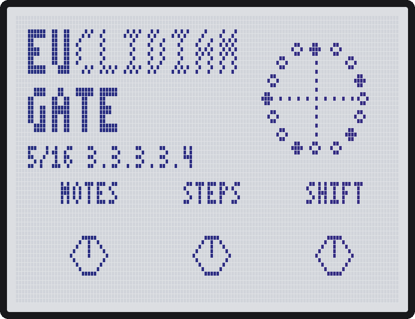
Chops the sound into a repeating rhythm. Every step is a 16th note. Notes are spread as evenly as possible over the steps (a Euclidean rhythm).

| Knob | Range | What it does |
|---|---|---|
| Notes | 1..64 | How many notes play. At or above Steps = every step. |
| Steps | 1..64 | Pattern length. Anything other than 16, 32 or 64 runs against the bar: polymeters. |
| Shift | 0..63 | Starts the pattern later by this many steps. |
| Swing | 0..100 | Delays only the weak 16ths. |
| Reset | OFF, NOTE, PEDAL | What else restarts the pattern (MIDI Start always does): nothing, every new note after silence, or turning the effect on. |
| Gap | 0..50 % of a step | Small silence at the end of a note that is followed by another note. |
| Soft | 0..100 | Softness of the note edges. 0 = hard chop. |
| Mix | 0..100 | Dry/wet crossfade, DJ style: the dry sound stays full up to 50, the effect is full from 50, so at 50 both play at full level. The gaps are silent in the wet sound. |

Try 5 notes in 16 steps (the default), then 7 in 12 or 5 in 12 for a different feel.

### DubSiren: dub siren with tape echo

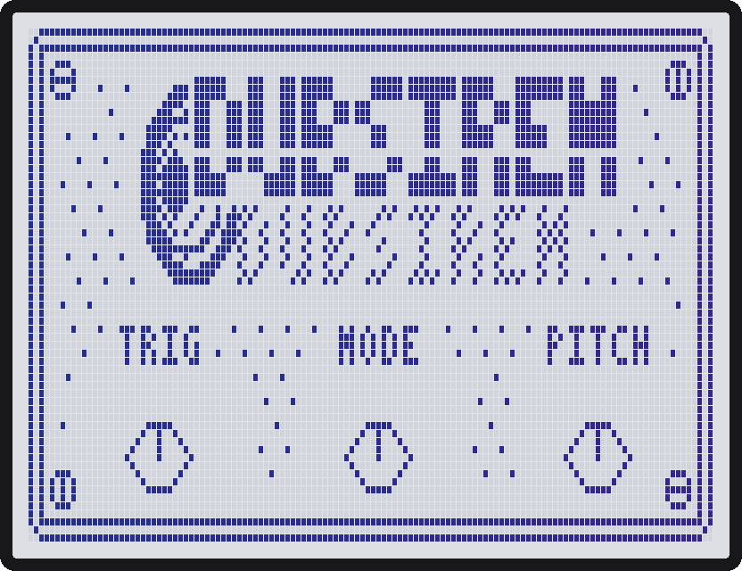
A siren oscillator with LFO modes, played from the footswitch, into its own tape-style echo. Your input passes through untouched.

| Knob | Range | What it does |
|---|---|---|
| Trig | Hold / Pulse / SHold / SPuls | Hold = sounds while the effect is on. Pulse = one short burst each time you turn it on. SHold and SPuls do the same on the beat: the siren waits for the next beat of the pedal's tempo (on the MIDI clock's beats while it runs) and the siren tones stay in step with the bar. |
| Mode | Wail, Fast, Slow, Laser | LFO shape. Fast is twice the Rate, Slow is half. |
| Pitch | 110 Hz..1760 Hz | Base pitch. |
| Rate | Man, 0.15..15 Hz, note values | LFO speed. The top of the knob syncs to the pedal's tempo as note values (4 bars .. 1/32). |
| Depth | 0..100 | How far the LFO sweeps the pitch. |
| Vol | 0..100 | Siren level. |
| Time | 50 ms..1 s | Echo time (never synced). |
| Fdbk | 0..125 | Echo repeats. 0 = no echo, above 100 it self-oscillates. |
| Pan | L50..C..R50 | Where the siren and its echo sit in the stereo field. The input passes through untouched on both sides. |

### S.GN_L: broken digital line

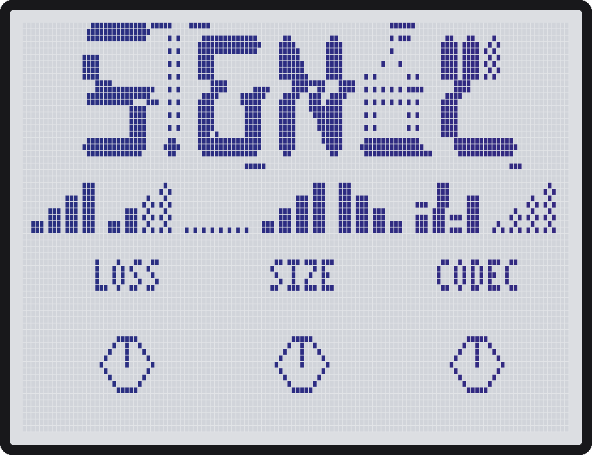
The sound is cut into packets and some of them never arrive, like a VoIP call on bad Wi-Fi or a digital radio losing lock. What fills the hole is most of the character: silence, the last packet replayed as a buzz or a stutter, a fading replay, or hiss. A Codec knob wrecks the quality on top (spectral holes, a closing low-pass, a lower sample rate, fewer bits). The file is `SGNL.ZDL`; the pedal shows the name S.GN_L.

| Knob | Range | What it does |
|---|---|---|
| Loss | 0..100 | How many packets are lost. 0 = clean line, 100 = about 85 %. |
| Size | 1 ms..400 ms | Packet length. Short = grit and, with REPT, a buzz at the packet rate (5 ms = about 200 Hz). Long = notes and words drop out or stutter. |
| Codec | 0..100 | Codec quality going down. Above 50 the first packet after a silence is lost too, like a call clipping the start of a word. |
| Fill | GAP, REPT, FADE, NOISE, REVRS, GARBL, LATE, RND | What replaces a lost packet: silence, the last packet replayed, the replay dying away, hiss at the level of the sound, the last packet backwards, corrupted data (boosted random slices, a digital screech), an older packet out of order so phrases shuffle, or a random one of these per outage (never GARBL). |
| Burst | 0..100 | 0 = scattered single losses, 100 = long outages, with the same overall amount. |
| Jump | 0..100 | How often the quality suddenly drops for a few packets and comes back. |
| Line | HIFI, VOIP, PHONE, WALKY | Band of the line: full and untouched, 200 Hz..5 kHz with a steep low cut and a boxy headset bump at 1.5 kHz, 300 Hz..3.4 kHz, or 500 Hz..2.5 kHz with some drive. |
| Edge | 0..100 | Cut at the packet edges. 0 = hard clicks, 100 = fades that fill most of the packet, so lost packets become soft dips and swells (longer with bigger Size). |
| Mix | 0..100 | Dry/wet crossfade, DJ style: dry full up to 50, wet full from 50, both full at 50. |

Try Size 5 ms with Fill REPT and Burst high for robot voice, or Size 60 ms, Fill GAP and Line PHONE for a bad call.

### Scrub: scrub through the past, freeze where you stop

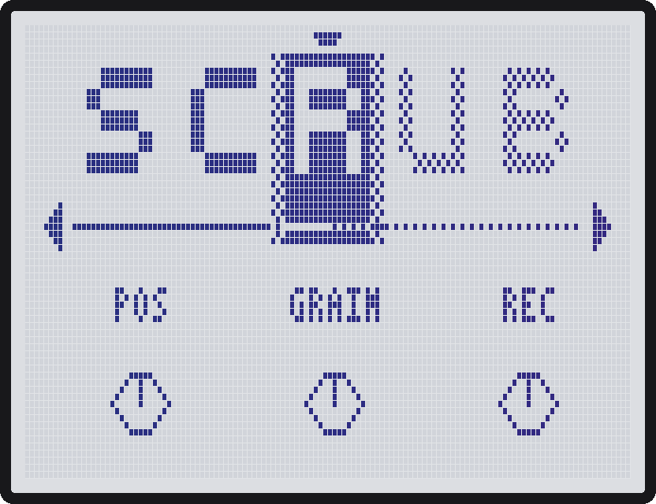
Everything you play is recorded into a 7.9 second buffer. Pos moves a read head through it: turning it, short grains follow the head through the audio at the original pitch, and when you stop, the grain just before the head loops on and on, crossfaded so the loop has no click. Known from Mutable Instruments Clouds/Beads (Position + Freeze) and the Morphagene.

| Knob | Range | What it does |
|---|---|---|
| Pos | 6.00 s..0 ms back | Where the head is in the last 6 seconds, in 10 ms steps (600 steps). The screen shows how far back it is; 0ms is the present (in HOLD, the moment you froze). |
| Grain | 10 ms..1 s, then 1/64..1/2 | Length of the loop. Short = a buzzing tone made of the sound, long = a whole hit or chord repeating. Past 1 s come note values synced to the pedal's tempo (1/64, 1/32, 1/16T, 1/16, 1/8T, 1/16., 1/8, 1/4T, 1/8., 1/4, 1/4., 1/2), so the freeze loops in time with the song. Long grains pull the head in so the whole grain still fits in the buffer: a synced grain over about 1 s, or with Dir REV, PING or RAND in LIVE any grain over about 0.6 s (a backward grain in LIVE reads further back, because the recording moves on under it). A synced grain too long to fit even at 0ms (1/2 below about 55 BPM, backward in LIVE) is shortened. |
| Rec | LIVE, HOLD, STOMP | LIVE keeps recording, so Pos is how far back you listen: a delay you can sweep. HOLD stops recording and Pos scrubs the last 6 of the 7.9 seconds kept. STOMP records while the effect is switched off and freezes the moment you switch it on (needs the pedal to pass the sound through a switched-off effect; if ON gives silence, use LIVE and HOLD). |
| Glide | 0..100 | How slowly the head follows Pos. 0 = it jumps, 40 = about 0.1 s, 100 = about 3 s, a slow glide. It also hides the knob's steps. |
| Dir | FWD, REV, PING, RAND | Which way the grain plays: forward, backward, ping-pong (forward then backward in turns) or random (each grain flips a coin). PING turns round on itself, so the loop has no jump and sounds smoother and more tonal. |
| Spray | OFF, +-1..+-250 | Random offset for each new grain, either side of the head, shown in ms (+-250 = up to 250 ms before or after; never ahead of now): a moving cloud instead of a steady loop. |
| Mix | 0..100 | Dry/wet crossfade, DJ style: dry full up to 50, wet full from 50, both full at 50. |
| Stereo | MONO, ST | MONO: one 7.9 s buffer of the two inputs added together, a mono freeze (the dry keeps left and right). ST: a buffer per side, 3.9 s, a true stereo freeze (Pos beyond 3.9 s is held at the limit). Changing it restarts the buffer. |

Try: play a Digitakt loop in LIVE, turn Rec to HOLD, then sweep Pos slowly with Glide around 60 and stop on a snare. Grain 10..30 ms on a held synth chord gives a buzzy drone; Spray 30 makes it a cloud.

### GRDELAY: one tempo-synced delay, six engines

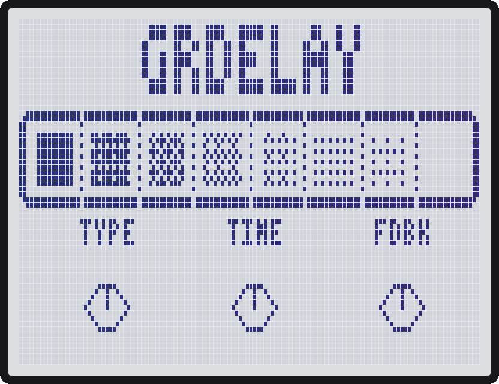
Built and tested on the MS-60B (2026-10-07).

One delay with a 7.9 second mono memory (3.9 s in the stereo modes). Type picks the engine, Time sets the echo (free or a note value at the pedal's tempo), and Char changes what it means with each engine.

| Knob | Range | What it does |
|---|---|---|
| Type | DIGI, TAPE, DUB, REVRS, TAPS, LOFI | DIGI: clean repeats. TAPE: wobbly, darker, slightly saturated, and a Time or tempo change glides the pitch like tape. DUB: band-limited, saturated repeats, the dirtiest drone above Fdbk 100. REVRS: each chunk of Time plays backwards; with a note-value Time, chunks follow the MIDI clock's grid. TAPS: three echoes inside Time, each quieter. LOFI: every repeat loses bits and sample rate, so it crumbles more each time. |
| Time | 12 ms..1.00 s, then 1/32..1bar, 2bar | Free time on the first 100 steps (as DualShft), then note values at the pedal's tempo: 1/32, 1/16T, 1/16, 1/8T, 1/16., 1/8, 1/4T, 1/8., 1/4, 1/4., 1/2, 1bar, 2bar. A time too long for the memory is halved (2bar below about 61 BPM; REVRS needs twice the time, so 1bar below about 61 BPM). Away from TAPE, a Time change crossfades with no pitch bend. |
| Fdbk | 0..120 | How many repeats. 100 = 1:1 into the loop: the repeats only fade by what the engine's filters take (DUB fastest). Above 100 they grow into a drone, DUB too at any Tone. |
| Tone | 0..100 | Dark to bright repeats. On DUB it moves the whole band up (thin and nasal at 100). |
| Char | 0..100 | DIGI: slight chorus on the repeats. TAPE: wow and flutter depth. DUB: drive. REVRS: the fade at each chunk's edges, choppy at 0, smooth at 100. TAPS: the pattern (0..24: 1/4, 1/2, 1 of Time; 25..49: 3/8, 3/4, 1; 50..74: 1/3, 2/3, 1; 75..100: 1/2, 3/4, 1). LOFI: crush, from 12 bits to 4 bits and 1/8 of the sample rate. |
| Duck | 0..100 | The repeats dip while you play and swell back in the gaps. 0 = off. |
| Mix | 0..100 | Dry/wet crossfade, DJ style: dry full up to 50, wet full from 50, both full at 50. |
| Tail | OFF, ON | When you switch the effect off: ON lets the repeats ring out and fade, like the stock delays; OFF stops them at once. The dry sound passes untouched either way. |
| Stereo | MONO, ST, PING | MONO: one 7.9 s mono delay. ST (default): a delay per side, 3.9 s, left in left out, right in right out. PING: ping-pong from one 3.9 s buffer, repeats alternate left and right (Time is the gap between repeats, at most about 1.9 s). Changing it restarts the buffer. |

Try: DUB at 1/8., Fdbk 85, Char 60, then sweep Tone for dub throws on a snare. REVRS at 1bar on a pad with a MIDI clock running. TAPS with Char 50 on hats for a triplet trail.

### Breather: tempo-synced pump with a reverb

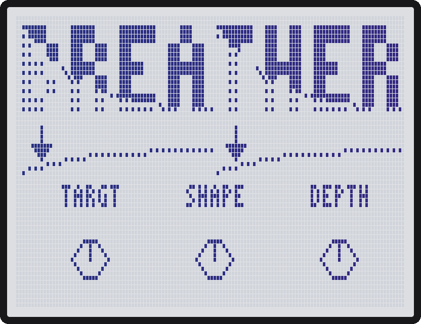
Built and tested on the MS-60B (2026-10-07).

On every beat (or every Div) something moves: your sound, the built-in reverb, both, or what goes into the reverb. Targt picks what, Shape picks how. Made for pads, basses, percussion and drum machines around 160 BPM.

| Knob | Range | What it does |
|---|---|---|
| Targt | DRY, VERB, BOTH, SEND | What moves. DRY = your sound (the reverb stays steady). VERB = only the reverb; your sound passes untouched. BOTH = both together. SEND = what goes into the reverb: your sound is untouched and the tail rings out freely. |
| Shape | DUCK, GATE, RISE | How it moves, starting on the downbeat. DUCK drops on the beat and comes back (classic sidechain pump). GATE cuts on the beat, stays cut for Curve, then opens (a hard duck). RISE is quiet after the beat, grows into the next one and drops on it. |
| Depth | 0..100 | How far the level moves. 100 = all the way to silence. |
| Div | 1/16, 1/8, 1/4, 1/2, BAR | How often it fires. |
| Shift | 0..100 % of a beat | Moves the whole pump later: +1/16 at 25, +1/8 (the offbeat) at 50, +3/16 at 75, +1/4 at 100. Small values nudge it onto the body of the kick. At 50 the sound is loudest on the kick and dips in between. |
| Curve | 0..100 | How long each move lasts, 5 % to 100 % of the Div: the recovery for DUCK, how long GATE stays cut, how long RISE grows. |
| Verb | 0..100 | Reverb level. 0 = no reverb, a pure pump. |
| Size | 0..100 | Reverb length, from a short room to a long wash. Bigger is also darker. |

No Mix knob: Depth and Verb already set how much you hear. Out of the box it is a sidechain pump on your sound and the reverb together (BOTH + DUCK, Depth 80, 1/4, Verb 35). Switched off, the input passes untouched but the beat clock keeps following the MIDI clock, so the pump comes back on the bar. Switching it on restarts it on the one, unless a MIDI clock is running (then it stays on the clock).

Try: DRY + DUCK on a pad (the classic pump); DRY + GATE (hard pump: silent on the kick, back after Curve); VERB + RISE (the reverb swells into every kick); SEND + GATE (the hits stay dry, the gaps wash out); DRY + GATE with Shift 50 and Curve 50 (open on the beat, cut on the offbeat: a chop).

### DIRTBOX: a distortion box for an acid machine

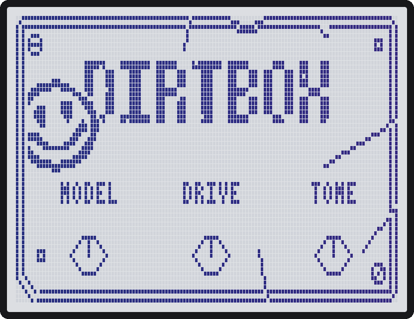
Built and tested on the MS-60B (2026-10-07).

Made for a TB-303 / TD-3 (or a MeeBlip triode) going into the pedal: seven real distortion pedals on the Model knob, mildest first, a 3-band EQ voiced for acid, and an automatic noise reducer (ZNR). Same fxid 491 as the first 3-model DirtBox. Drive mostly adds dirt rather than volume: an input peaking around -14 dBFS comes out at about the same level at any Drive.

Each model follows the real circuit stage by stage, from a published analysis or a circuit-level digital model (filters evaluated at 44.1 kHz, diode and transistor curves fitted to the model's):

- **TS9**: Ibanez TS9 Tube Screamer, after guitarix's [ts9sim](https://github.com/brummer10/guitarix/blob/master/trunk/src/plugins/ts9sim.dsp): gain only above 720 Hz, the 1N914s soft-clipping in the feedback, the 723 Hz low-pass with the treble control. The mid-hump overdrive.
- **DIST+**: MXR Distortion+, after the ElectroSmash analysis and guitarix's [mxrdist](https://github.com/brummer10/guitarix/blob/master/trunk/src/LV2/faust/mxrdist.dsp): 741 gain up to 214x, the 741's limited bandwidth, germanium diodes. The pedal has no tone knob, so Tone is a gentle low-pass.
- **DS-1**: the distortion built into the Behringer TD-3, a copy of the Boss DS-1 ([ElectroSmash](https://www.electrosmash.com/boss-ds1-analysis), [DS1.lv2](https://github.com/LiamLombard/DS1.lv2)): 35 dB booster, op-amp stage, 1N4148s, the DS-1 tone.
- **RAT2**: ProCo RAT 2 (same gain stage and clipper as the RAT), after the [Proco-Rat nodal model](https://github.com/Rudro085/Proco-Rat): two gain legs, the LM308's treble loss as gain rises, 1N914s, the Filter.
- **MUFF**: Big Muff Pi, guitarix's [bmp](https://github.com/brummer10/guitarix/blob/master/trunk/src/LV2/faust/bmp.dsp) circuit model: two transistor clipping stages and the Big Muff tone stack (noon = the mid scoop). Drive = Sustain. The Muff's input booster (about +24 dB), which bmp leaves out, is added back, so it saturates at synth levels like the real pedal.
- **SFUZZ**: Univox Super-Fuzz, from the schematic (no circuit-level digital model was found): high-gain preamp, the push-push doubler (octave up), germanium diodes. Tone = the Tone switch made continuous: 0 = the 1 kHz scoop fully in (fat and bassy), 100 = off. Drive = Expander.
- **MT-2**: Boss MT-2 Metal Zone, guitarix's [MetalTone](https://github.com/brummer10/MetalTone) circuit model: +25 dB mid pre-filter, Dist stage, the clipper, the post filter. Tone = the High knob.

Only RAT2 is nearly clean at Drive 0; the others still distort at 0, as the real pedals do. No oversampling, so high notes at full Drive alias a little.

| Knob | Range | What it does |
|---|---|---|
| Model | TS9, DIST+, DS-1, RAT2, MUFF, SFUZZ, MT-2 | Which pedal, mildest first. Default RAT2. Switching fades the effect back in over a few ms so it doesn't click. |
| Drive | 0..100 | The pedal's own gain knob (Drive, Distortion, Dist, Sustain, Expander). |
| Tone | 0..100 | The pedal's tone control, 100 = brightest. Default 80. |
| Low | -12..+12 dB | Shelf at 110 Hz: the 303's body. 0 = flat (default). |
| Mid | -12..+12 dB | Peak at 1 kHz: the squelch of the resonance. 0 = flat (default). |
| High | -12..+12 dB | Shelf at 4.5 kHz: the fizz. 0 = flat (default). |
| ZNR | 0..100 | Noise reducer on the distorted sound only. It measures your noise floor by itself and stays shut this far above it: +9 dB at 1, +19.5 dB at 50, +30 dB at 100. 0 = off. |
| Level | 0..100 | Distorted level, 50 = about the input level, 100 = +6 dB. |
| Mix | 0..100 | Dry/wet crossfade, DJ style: dry full up to 50, wet full from 50, both full at 50 (parallel distortion). |

**ZNR for acid lines.** It listens to the clean input, not the distorted sound, so it follows each note's real decay. The noise floor it measures can never be set above -60 dBFS, so the threshold never climbs into the music. Below the threshold it waits 30 ms, then turns the distortion down firmly (a 1:5 expander, which takes hiss down by about 75 dB at ZNR 50) over about 80 ms: quick enough to clear the hiss in a rest between 16ths at 140 BPM, while a note's tail still fades the way it does on the input. More gain means more hiss to clear; turning ZNR up cuts more.

Try: TD-3 into RAT2 at Drive 50, Tone 80, Mid +3 for a classic squelch; DS-1 for the TD-3's own distortion sound; SFUZZ with Tone 0 and Low +4 for fat, octave-up drones; Mix 50 to keep the clean line under the dirt.

### Sweep: phaser, flanger and filter in one

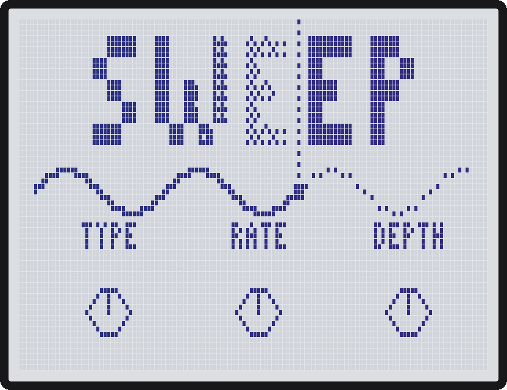
Built and tested on the MS-60B (2026-10-07).

One tempo-locked LFO sweeps one of three engines, picked with Type. Meant for synths and drum machines.

| Knob | Range | What it does |
|---|---|---|
| Type | PH 4, PH 8, FL +, FL -, LP, BP, HP, NTCH | The engine. PH 4 / PH 8: phaser with 4 or 8 all-pass stages (2 or 4 notches). FL +: flanger. FL -: flanger with negative feedback, hollow and metallic. LP / BP / HP / NTCH: resonant low-pass, band-pass, high-pass, notch. |
| Rate | 0.05..8 Hz, then 8BAR, 7BAR .. 2BAR, 1.5B, 1BAR, 3/4, 1/2, 1/4, 1/8, 1/16, 1/32 | The knob goes faster all the way up. Free speed in Hz on the lower part; at the top, one full sweep (up and down) lasts a number of bars or a note value at the pedal's tempo, slowest (8 bars) first, fastest (1/32 note) last. |
| Depth | 0..100 | How far the sweep goes each way around Cntr. 0 = parked, 100 = 2.5 octaves each way. |
| Cntr | 0..100 | Where it sweeps around. Phaser notch and filter cutoff 80 Hz to 10 kHz; flanger delay 8 ms down to 0.3 ms. Higher is brighter for all three. |
| Reso | 0..100 | Feedback (phaser, flanger; the sign comes from Type) or filter resonance. |
| Shape | TRI, SINE, RISE, FALL, SQR, RAND | LFO shape. TRI and SINE start at the centre and rise. RAND glides to a new random height twice per sweep. |
| Tone | 0..100 | Phaser and flanger: how bright the feedback is. Filters: drive into the filter, with the level kept about the same. |
| Mix | 0..100 | Dry/wet crossfade, DJ style. The phaser and flanger sound already contains the dry (that is where the notches come from), so 100 is the whole effect. |

Try: LP, Reso 60, Rate 1BAR, Shape RISE on a drum loop for a filter build; PH 8 on a pad with Rate 4BAR; FL - at Reso 70, Cntr 70 for a jet.

### LOUDER: a mastering limiter

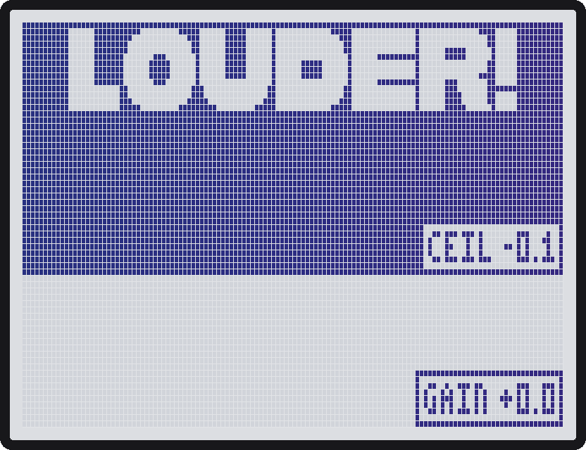
Stereo in and out, for the end of the chain (after MIX).

A transparent look-ahead limiter in the Pro-L / Ozone Maximizer family: it pushes the level up and holds it under the ceiling. One gain for both sides, taken from the louder one. The sound is delayed by 1.5 ms so the gain is already down when a peak arrives: no clipping, no click. Anything the limiter does not catch is cut by a hard clip at Ceil (after Mix, so the ceiling holds at any Mix).

| Knob | Range | What it does |
|---|---|---|
| Gain | 0.0 .. +18.0 dB | How hard the sound is pushed into the limiter, 0.1 dB steps. Default 0. |
| Ceil | -6.0 .. 0.0 dB | The ceiling: nothing comes out above it. 0.1 dB steps. Default -0.1 dB. |
| Zoom | x0.5 .. x8.0 | Meter only: rows a dB, scaled around the ceiling line. Default x3. |
| Rels | AUTO, 1 .. 1000 ms | Release. AUTO is program-dependent: a fast stage (30 ms) lets go after single peaks, a slow one (250 ms) after sustained level, so it does not pump. A number is one stage with that time. |
| Style | CLEAN, PUNCH, LOUD | Only the saturation before the limiter and how much transient gets through (never the release). CLEAN has none, PUNCH adds a little and lets transients through a little, LOUD is the densest. |
| Mix | 0..100 | Dry/wet crossfade, DJ style (parallel limiting). The dry is delayed like the wet, so a part Mix never sounds like a comb filter. |

At Gain 0 and Mix 100, a signal under the ceiling comes out unchanged (just 1.5 ms later). The cover is a live meter drawn by the effect itself: a scrolling history of the last 4 beats of the level after Gain (one column = 1/32 beat), with the ceiling as a centered line tagged CEIL and GAIN. What pokes out of the box above the line is what the limiter takes off. It scrolls with the MIDI clock when it runs, else with tap or patch tempo. It works on any MS-70CDR on firmware 2.10, stock included, and on the MS-50G firmware 3.10 (addresses mapped from its OS, see `src/custom/common/zdl_meter.h`); on other firmware the cover stays static.

### DJFilter: a DJ filter and kick kill

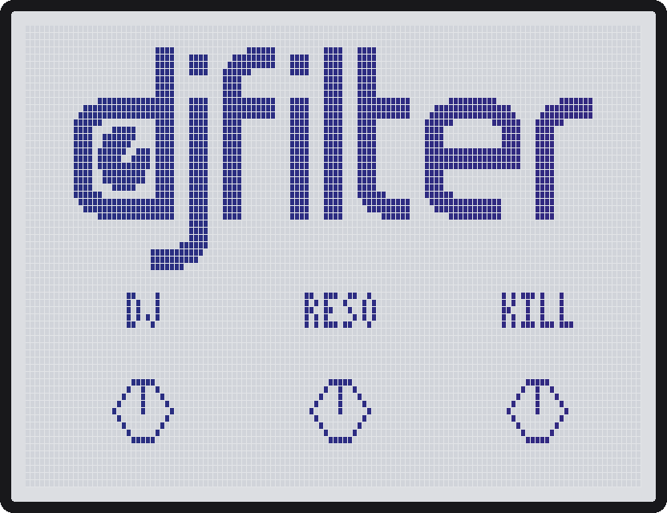
Stereo in and out.

The DJ mixer filter (Xone / DJM style) you ride by hand, from a CC or Perform, with a kick kill for transitions. One DJ knob: left closes the highs (low-pass), right closes the lows (high-pass), -3..+3 is flat and costs nothing. Turning away from the middle is always more filtering, exponential in frequency. The footswitch is a plain on/off, ramped over a few ms so it never clicks: press it for the kick kill (Kill 120 Hz, filter open).

| Knob | Range | What it does |
|---|---|---|
| DJ | -100..+100 | Left low-pass (-100 closes down to about 40 Hz), right high-pass (+100 closes up to about 10 kHz), -3..+3 is flat. |
| Reso | 0..100 | Resonance at the far end of the sweep. About none when the filter is open, rising as it closes, never self-oscillating. Default 30. |
| Kill | OFF, 20..300 Hz | An independent 24 dB/oct low cut that removes kick and bass. Use it alone or on top of the filter. Default OFF. |
| Slope | 12 / 24 | dB per octave of the filter (not Kill). 12 is gentle and warm, 24 is the hard DJ-mixer cut. Default 24. |
| Glide | 0..1000 ms | How fast the filter follows DJ, so a fast CC or Perform jump sweeps instead of stepping. Default about 20 ms. |
| Level | -12.0..+6.0 dB | Output trim. |
| Mix | 0..100 | Dry/wet crossfade, DJ style. Default 100. |

### Washout: a delay that melts into a cloud

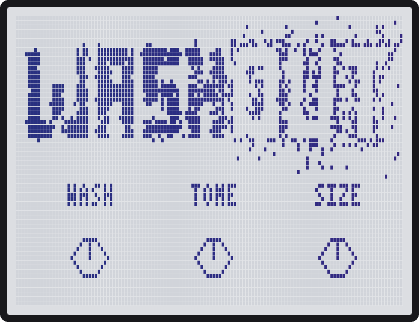
Stereo in and out.

A tempo-synced stereo feedback delay with a chain of 4 all-pass diffusers inside the loop: every pass through the loop smears the sound more, so the repeats melt into a reverb-like cloud (the Octatrack-style washout for transitions). Left and right have their own delay and their own diffusers, so a mono input still comes out wide. The diffusers lose no level, so Fdbk 100 with Send 0 and both cuts off holds the cloud for as long as you like; above 100 it grows, held by a soft clip. There is no Mix knob: Send is a crossfade-send (like the macro knob of Baby Audio Transit). Turning it up sends more input into the wash and fades the dry down in one equal-power move, so the level stays even. The footswitch is a plain on/off with trails: off stops new sound going in, the dry comes back to full level and the tail rings out. When the tail has died and nothing goes in, it costs next to nothing.

| Knob | Range | What it does |
|---|---|---|
| Time | 12 ms..1.00 s, then 1/32 .. 1bar, 2bar | As GRDELAY, locked to the pedal's tempo. The ring holds 3.8 s: longer synced times are halved until they fit. Default 1/4. |
| Wash | 0..100 | Diffusion: how much each pass smears. 0 skips the diffusers. Default 70. |
| Fdbk | 0..120 | Repeats. 100 = 1:1; above 100 it grows and is soft-clipped. Switched off it is capped at 95 so the tail fades. Default 60. |
| HiCut | 0..100 | Low-pass on the repeats: the first repeat is darker, each pass darker still. 0 = off. |
| LoCut | 0..100 | High-pass on the repeats: the first repeat is thinner, each pass thinner still. 0 = off. |
| Width | 0..100 | Stereo width of the wet signal; 0 = mono. Default 100. |
| Send | 0..100 | Crossfade-send, smoothed: 0 = dry only at full level (the tail keeps ringing), 50 = both, 100 = wash only, dry silent. Turn it up and back down for a throw. Default 100. |

Try: Send 50 to sit the cloud under the dry; Fdbk 100, then Send 0 to freeze the cloud under the dry; Send 100 and Fdbk 110 with HiCut 40 for a dark swell that swallows the track.

### Takeoff: risers and downlifters

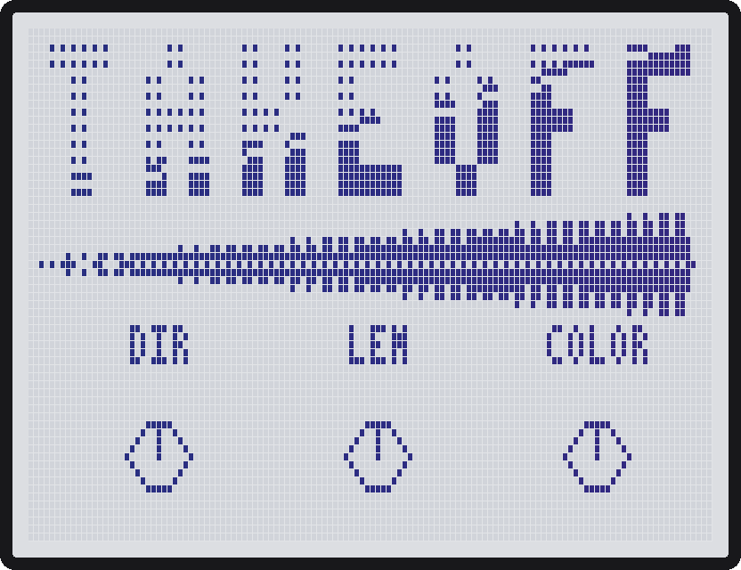
Stereo in and out. Hold needs MIDISTOMP's HOLD FOR = MOMENTARY.

Adds a riser or a downlifter on top of what you play, like DubSiren: the input is never touched, Vol sets the added sound. Any on/off flip fires one sweep over Length, at once (no wait for the bar). A flip during the sweep or the tail drops it. Hold the footswitch (MIDISTOMP with HOLD FOR set to MOMENTARY) and it rises while you hold and drops when you let go (letting go only drops, it never fires a new sweep); it sits at the top if you hold past the end of Length. The sound is noise through a resonant sweeping filter; the volume swells with the sweep. It is mono, the same on both sides, starting from a root of 50 Hz. On MIDISTOMP v2.0.1 (play mode, cursor on Takeoff) the footswitch LED is off at rest and follows the sound: it fades up with the riser and out with the tail; on stock it stays as the firmware shows it. When nothing is sounding it costs next to nothing.

| Knob | Range | What it does |
|---|---|---|
| Dir | UP / DOWN | UP sweeps up and cuts clean at the end (or fades over Tail). DOWN starts at the top, falls and fades. Default UP. |
| Length | 1/2/4/8/16 bars, or 1..31 s | Sweep length (bars at the pedal's tempo). Default 4 bars. |
| Color | 0..100 | Noise tone: low = a narrow whistling resonance, high = a wide airy hiss. Default 25. |
| Wind | 0..100 | Slow random gusts: the noise filter and level drift on their own, apart on left and right. 0 = steady. Default 40. |
| Grain | 0..100 | Noise texture: 0 = smooth hiss, up = coarse, crackly, gritty. Default 0. |
| Range | 0..100 | How far the noise sweep travels (0..5 octaves): small = a short, subtle lift, 100 = from deep rumble to full air. Default 60 (3 octaves). |
| Var | 0..100 | How much each takeoff differs from the last: Range (up to a third more or less), start pitch, curve, Color, Wind and Grain, drawn once per sweep. Length, Dir, Tail and Vol never change and the level stays even. 0 = the same takeoff every time. Default 35. |
| Tail | Off, 1/2/4/8/16 bars, or 1..31 s | UP only: after the peak the noise settles about 6 dB lower, like a reverb after the hit, and fades out over this time instead of cutting (also after a hold). Does nothing on DOWN. Default Off. |
| Vol | 0..100 | Level of the added sound. Default 50. |

Try: UP, Length 8 bars, Wind 60, Tail 1 bar for a classic build-up; Range 20, Length 1 bar for a quick lift into a chorus; DOWN, Color 80 for a wide downlifter; Color 0, Grain 70 for a gritty whistle; Var 0 when every drop must sound the same.

### Gooey: a mix bus compressor

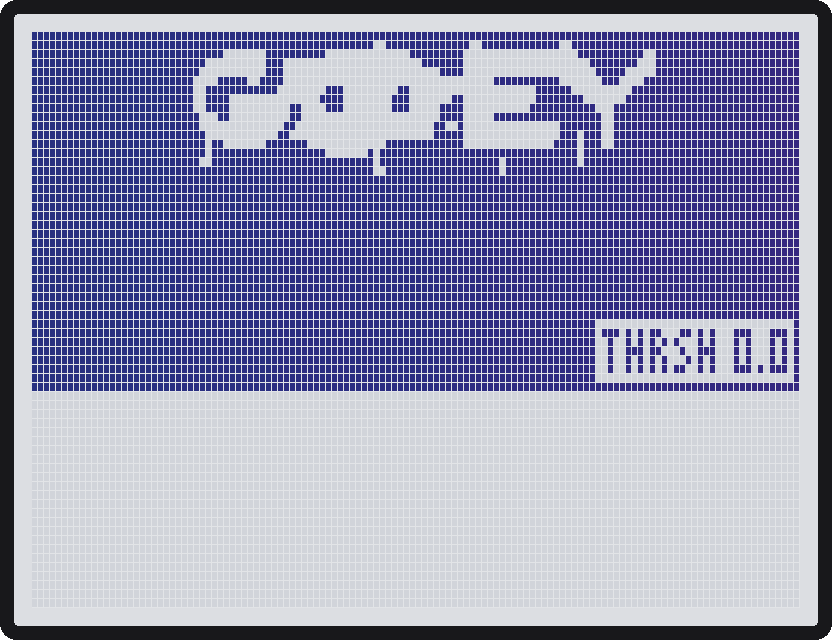
Stereo in and out.

An SSL G-bus style VCA compressor to glue a mix: one character, done well. One gain for both sides, taken from the louder one (half peak, half RMS detector, soft knee). The sidechain high-pass listens only to the detector, so a kick does not pump the whole mix and the sound itself is never filtered. Thrsh at 0 bypasses it completely.

| Knob | Range | What it does |
|---|---|---|
| Thrsh | -40 .. 0 dB | Threshold in 0.1 dB steps. 0 = OFF (bit-exact bypass, no cost). Default 0. |
| Ratio | 1.5, 2, 4, 10 | Default 4. |
| Zoom | x0.5 .. x8.0 | Meter only: rows a dB, scaled around the threshold line. Default x1. |
| Attck | 0.1, 0.3, 1, 3, 10, 30 ms | Default 10 ms. |
| Rels | 0.1, 0.3, 0.6, 1.2 s, AUTO | AUTO is program-dependent: 0.1 s after single peaks, up to 1.2 s after sustained reduction, so it does not pump. Default AUTO. |
| MkUp | AUTO, OFF, +0.5 .. +20 dB | AUTO adds back the average gain reduction. Default OFF. |
| Mix | 0..100 | Linear dry/wet blend like the Digitakt compressor (parallel compression), so Mix 50 is not louder. Default 100. |
| SC HP | OFF, 20 .. 300 Hz | High-pass on the detector only (12 dB/oct). Default OFF. |

Try: Thrsh -12, Ratio 2, Attck 30 ms, Rels AUTO, MkUp AUTO, SC HP 100 Hz on a full mix for glue; Ratio 10, Attck 1 ms, Mix 50 on drums for parallel punch. The cover is a live meter drawn by the effect itself: a scrolling history of the last 4 beats of the output level (one column = 1/32 beat), with the threshold as a centered line tagged THRSH. It scrolls with the MIDI clock when it runs, else with tap or patch tempo. It works on any MS-70CDR on firmware 2.10, stock included, and on the MS-50G firmware 3.10 (addresses mapped from its OS, see `src/custom/common/zdl_meter.h`); on other firmware the cover stays static.

### GRDLOOP: a bar-synced looper on the song grid

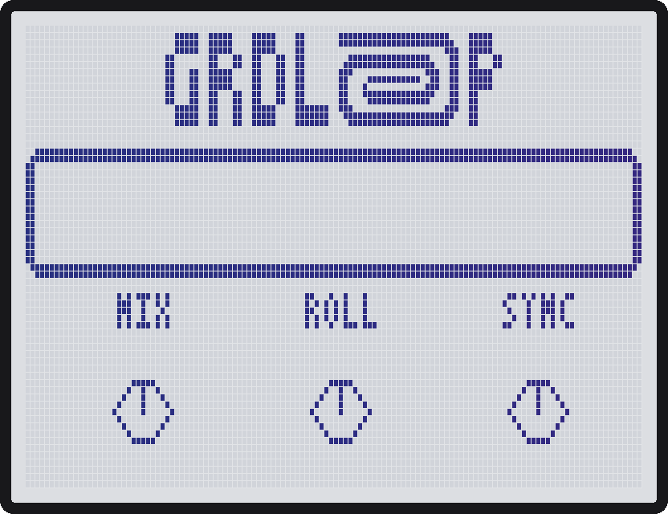
Stereo in and out. Made for MIDISTOMP v2.0.1; on stock firmware it works in a reduced form: every on/off flip is a press, the press that records is bar 1, it follows the tap tempo, and it holds about 9 s mono or 4.9 s stereo.

The song grid: with a MIDI clock running, bar 1 is MIDI Start. Without one it runs at the pedal's tempo, and the press that records an empty looper is bar 1, so the first recording starts at once.

**Footswitch.** On MIDISTOMP v2.0.1, with GRDLOOP under the cursor, the footswitch is a press: the effect never flips, a hold does nothing, the patch is not marked edited and the LED shows the state. GRDLOOP's on/off CC (14, 24 ... 64 by position) is a press for values 64-127, whatever is on screen. On stock firmware, and for a second GRDLOOP in the same patch, every on/off flip is a press, the LED means nothing, and each flip marks the patch as edited.

| State | Press | Double press (two within 300 ms) |
|---|---|---|
| Empty | record (see Sync), then play | — |
| Recording | Sync OWN: end the recording (rounded up to whole cycles). SLAVE: nothing | throw the recording away |
| Playing | stop (the loop is kept) | delete the loop |
| Stopped | play again, in its place on the grid | delete the loop |

Record, stop and play wait for the Next line; delete is always at once. MIDI Start moves a waiting action to the downbeat, and a recording under way starts again on the downbeat. What MIDI Stop does is the Stop knob.

| Knob | Range | What it does |
|---|---|---|
| Mix | 0..100 | Live and loop, DJ crossfade: live full up to 50, loop full from 50. With no loop playing only the live part is heard (100 = silence). In Mixer Mode's Parallel mode keep it at 100 and use [MIX]'s Crossfade. Default 50. |
| Roll | OFF, 1/2, 1/4, 1/8, 1/16, 1/32 | Latched beat repeat of a slice of the bar: it starts on the next bar line. A new rate takes over on its next line; OFF lands on the next line, where the loop would have been. Default OFF. |
| Sync | OWN, SLAVE | OWN: record from the Next line until the Next line after your second press, rounded up to whole cycles. SLAVE: record one cycle, then play. Default OWN. |
| Next | NOW, BEAT, BAR, CYC | When record, stop and play land: at once (a single press waits 300 ms in case it is a double), the next beat, the next bar, or the next cycle start counted from bar 1. Default CYC. |
| Cycle | 1..32 bars | The cycle length. Perform mode's CYCLE overrides it when set. Default 8 bars. |
| Stop | KEEP, HALT | KEEP: MIDI Stop and clock loss are ignored, the loop plays on at the last tempo and waiting actions keep waiting; the next MIDI Start restarts it at bar 1. HALT: MIDI Stop stops the loop and drops waiting actions; Start plays it from bar 1. Default KEEP. |

Old Looper patches load: Length 2 bars reads as SLAVE (others OWN), When maps to Next (IMMED = NOW) and Amount to Cycle.

**Memory.** 12-bit block floating point. On MIDISTOMP v2.0.1 one GRDLOOP per patch gets the firmware's big buffer, 3.3 MB: 23.3 s stereo or 43.2 s mono, so 8 bars stereo from 83 BPM and mono from 45 BPM. On stock firmware, or for a second GRDLOOP, only the effect's own 705 KB: about 9 s mono or 4.9 s stereo. Stereo whenever a cycle fits, else mono ((L+R)/2), else shorter (the screen shows REC n/m). The loop is lost on a patch change. Everything GRDLOOP leaves in the slot's memory reads as silence, so a stock delay or reverb loaded into that slot afterwards starts clean.

**Screen and LED** (MIDISTOMP v2.0.1). A box on GRDLOOP's screens (top right of the knob pages, under LOOPER on the cover) shows EMPTY, REC WAIT, REC (REC MONO when the loop fell back to mono), PLAY, STOP or DEL WAIT, with a bar that is always there: it fills as the recording goes on, shows the place in the loop while playing or stopped, and fills up to the line while REC WAIT waits. Only the bar blinks, never the whole box: while recording it goes off for an 1/8 every 2 beats; while an action waits it blinks (STOP or PLAY show while waiting to stop or play), faster as the moment comes, from once per 2 bars down to 1/8 notes. The LED, while GRDLOOP is under the cursor: off when empty or stopped, a fade every 2 beats while recording, on while playing, the same countdown blink while an action waits. A double press while stopped deletes at once.

**Tempo changes.** The loop stays on the grid and keeps its pitch. Every 1/16 line it checks where it should be. Faster than recorded, each 1/16 is cut short at the next line. Slower, a 1/16 that runs out is filled with overlapping 30 ms grains of its own tail (15 ms crossfades) until the line, so sustained sounds stretch smoothly and no attack is heard twice; the hits stay on their lines. The grain size is the constant `LP_GX` in looper.c. At the recording tempo nothing moves.
